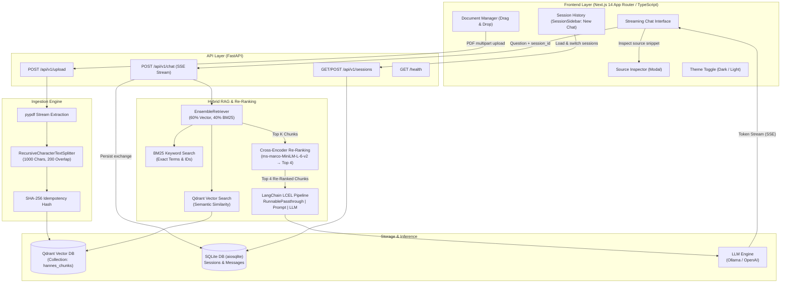

# Hannes AI

[](https://www.python.org/downloads/)
[](https://fastapi.tiangolo.com)
[](https://nextjs.org/)
[](https://www.typescriptlang.org/)
[](https://qdrant.tech/)
[](https://ollama.com/)
[](https://opensource.org/licenses/MIT)

Hannes AI is a production-grade Retrieval-Augmented Generation (RAG) platform designed for high-accuracy document intelligence and question-answering over PDF documents. It merges dense vector search (Cosine) with lexical keyword matching (BM25), applies local Cross-Encoder re-ranking (`ms-marco-MiniLM-L-6-v2`), streams answers token-by-token over Server-Sent Events (SSE), and persists chat sessions and source citations in a local SQLite database.

The entire stack runs 100% locally with zero cloud API dependencies (Ollama `llama3` + `nomic-embed-text`, local Cross-Encoder, and local Qdrant). Pluggable dependency injection allows switching to external providers (e.g., OpenAI) via environment configuration.

---

## Architecture



---

## Technical Highlights

### 1. Hybrid Retrieval & Local Cross-Encoder Re-Ranking
Pure vector search frequently struggles with domain terms, serial numbers, and legal codes. Hannes AI addresses this through a two-stage retrieval pipeline:
- **Stage 1 (Hybrid Search):** `EnsembleRetriever` combines dense semantic vectors (`nomic-embed-text`, 768-dim) in Qdrant with sparse BM25 scoring (`rank_bm25`).
- **Stage 2 (Cross-Encoder Re-Ranking):** A local HuggingFace Cross-Encoder model (`cross-encoder/ms-marco-MiniLM-L-6-v2` via `sentence-transformers`) scores each `(query, document_passage)` pair jointly, pruning the candidate set down to the top 4 most relevant excerpts before prompt construction.

### 2. Multi-Turn Session Persistence
- Chat sessions and messages are persisted asynchronously in SQLite via SQLAlchemy 2.0 (`aiosqlite`) using `selectinload` and strictly-typed column definitions (`Mapped[...]`, `mapped_column[...]`).
- Multi-turn conversational context is injected directly into the LLM system prompt for contextual follow-up inquiries.
- Dynamic session title generation automatically labels the conversation based on the user's initial inquiry.
- Dedicated session management with one-click **"Neuer Chat"** creation and instant history restoration.

### 3. Server-Sent Events (SSE) Streaming & Source Attribution
- Unidirectional HTTP streaming (`text/event-stream`) avoiding WebSocket lifecycle complexity.
- Strongly-typed JSON stream frames:
  - `{"type": "token", "content": "..."}`: Real-time incremental token delivery.
  - `{"type": "sources", "sources": [...]}`: Structured citations with document filename, page number, relevance score, and text excerpt.
  - `{"type": "done"}`: Clean stream termination indicator.

### 4. 100% Local Execution & Pluggable Providers
- **Default:** Fully offline execution powered by Ollama (`llama3` + `nomic-embed-text`), containerized Qdrant, and local sentence-transformers inference.
- **Configurable:** Fast switching to OpenAI (`gpt-4o-mini` + `text-embedding-3-small`) by updating `LLM_PROVIDER=openai` in `.env`.

### 5. Achromatic Dark/Light Interface
- Purpose-built three-column layout (Session History, Document Management, Streaming Chat).
- Strictly achromatic palette (Tailwind `neutral` scale with identical R/G/B values) eliminating blue/tint bias.
- Fully persistent Dark / Light mode toggle.

---

## Project Structure

```text
hannes-ai/
├── backend/
│   ├── app/
│   │   ├── api/v1/
│   │   │   ├── upload.py           # Multipart PDF ingestion & chunking router
│   │   │   ├── chat.py             # SSE streaming chat router
│   │   │   └── sessions.py         # Session management & history REST router
│   │   ├── core/
│   │   │   ├── config.py           # Type-safe Pydantic v2 settings
│   │   │   ├── dependencies.py     # FastAPI dependency injection
│   │   │   └── logging.py          # Structured structlog JSON logging
│   │   ├── db/
│   │   │   ├── models.py           # SQLAlchemy 2.0 ORM (ChatSession, ChatMessage)
│   │   │   ├── database.py         # Async SQLite engine (aiosqlite)
│   │   │   └── repository.py       # Session & message data-access repository
│   │   ├── schemas/
│   │   │   ├── upload.py           # Ingestion request & response schemas
│   │   │   ├── chat.py             # Chat request & SSE event schemas
│   │   │   └── session.py          # Session & message response schemas
│   │   ├── services/
│   │   │   ├── ingestion.py        # PDF extraction (pypdf), splitting & Qdrant upsert
│   │   │   ├── reranker.py         # Local Cross-Encoder re-ranking service
│   │   │   └── rag.py              # Hybrid retrieval, re-ranking & LCEL execution
│   │   └── main.py                 # FastAPI application factory & lifespan
│   ├── tests/
│   │   ├── conftest.py             # Pytest fixtures & mocks
│   │   ├── test_upload.py          # Upload validation tests
│   │   ├── test_rag.py             # Retrieval, deduplication & streaming tests
│   │   ├── test_chat.py            # Chat SSE contract tests
│   │   └── test_sessions.py        # Session persistence integration tests
│   ├── Dockerfile                  # Multi-stage container build (python:3.11-slim)
│   └── requirements.txt            # Pinned Python dependencies
├── frontend/
│   ├── src/
│   │   ├── app/
│   │   │   ├── layout.tsx          # Root layout & theme configuration
│   │   │   ├── globals.css         # Achromatic scrollbars & focus styles
│   │   │   └── page.tsx            # Three-column layout (Sidebar | Documents | Chat)
│   │   ├── components/
│   │   │   ├── SessionSidebar.tsx  # Chat history with session switching & "Neuer Chat"
│   │   │   ├── DocumentManager.tsx # Drag & Drop PDF upload & document list
│   │   │   ├── ChatInterface.tsx   # SSE stream reader & prompt input
│   │   │   ├── MessageBubble.tsx   # Markdown renderer & source badges
│   │   │   ├── SourceModal.tsx     # Source citation inspection modal
│   │   │   ├── ThemeToggle.tsx     # Dark / Light theme switcher
│   │   │   └── ui/                 # Reusable UI primitives (Button, Badge)
│   │   ├── lib/
│   │   │   ├── api.ts              # Typed API client
│   │   │   ├── sse.ts              # SSE ReadableStream event parser
│   │   │   └── utils.ts            # Formatting utilities
│   │   └── types/                  # TypeScript interface definitions
│   ├── Dockerfile                  # Next.js standalone container build
│   └── package.json
├── docker-compose.yml              # Multi-container orchestration (Qdrant, Backend, Frontend)
├── .env.example                    # Configuration template
└── README.md
```

---

## Quickstart

### Prerequisites
- Docker Desktop / Docker Engine & Docker Compose
- [Ollama](https://ollama.com/) running locally with the required models:
  ```bash
  ollama pull llama3
  ollama pull nomic-embed-text
  ```

### 1. Configuration
```bash
git clone https://github.com/your-username/hannes-ai.git
cd hannes-ai

cp .env.example .env
```

### 2. Launch Services
```bash
docker compose up --build -d
```

### 3. Application Access
- **Web UI:** [http://localhost:3000](http://localhost:3000)
- **FastAPI OpenAPI Docs:** [http://localhost:8000/docs](http://localhost:8000/docs)
- **Qdrant Dashboard:** [http://localhost:6333/dashboard](http://localhost:6333/dashboard)
- **Health Check:** [http://localhost:8000/health](http://localhost:8000/health)

---

## Verification & Code Quality

```bash
# Run backend test suite
cd backend
pytest tests/ -v

# Run frontend type checking
cd frontend
npm run type-check
```

---

## License
MIT License.
