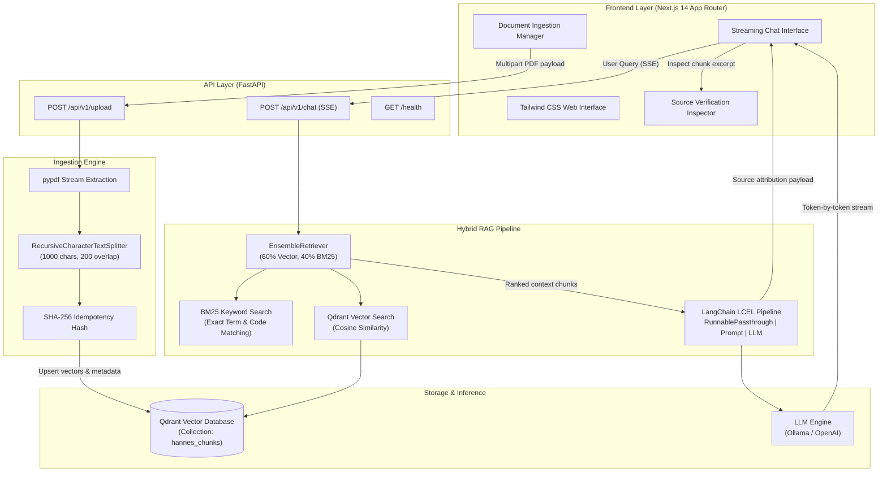

# Hannes AI

[](https://www.python.org/downloads/)
[](https://fastapi.tiangolo.com)
[](https://nextjs.org/)
[](https://www.typescriptlang.org/)
[](https://qdrant.tech/)
[](https://ollama.com/)
[](https://opensource.org/licenses/MIT)

Hannes AI is a Retrieval-Augmented Generation (RAG) platform designed for reliable document question answering. It pairs dense vector search with sparse keyword search (BM25), streams model tokens via Server-Sent Events (SSE), and guarantees strict source attribution down to individual document chunks and page numbers.

The system supports both local offline inference via Ollama (`llama3` + `nomic-embed-text`) and cloud-hosted inference via OpenAI (`gpt-4o-mini` + `text-embedding-3-small`) through a dependency-injected provider architecture.

---

## Architecture Overview



---

## Core Engineering Decisions

### 1. Hybrid Retrieval (BM25 + Dense Embeddings)
Pure semantic vector retrieval frequently misses exact identifiers, product codes, or legal clause references that lack dense semantic clustering. Hannes solves this using an `EnsembleRetriever`:
- **Dense Path:** `nomic-embed-text` (768-dim) or `text-embedding-3-small` (1536-dim) in Qdrant capturing semantic context.
- **Sparse Path:** `rank_bm25` operating over the in-memory chunk corpus for exact lexical match.
- **Weighted Fusion:** Linear reciprocal weighting (60% vector / 40% BM25) significantly reduces out-of-vocabulary hallucinations.

### 2. Idempotent Ingestion & Metadata Lineage
Re-uploading modified or identical documents must not corrupt vector index state:
- Each upload calculates a deterministic SHA-256 hash across filename and header bytes (`_compute_document_id`).
- Before indexing new splits, existing points matching the `document_id` are purged from Qdrant.
- Every chunk preserves strict lineage: `document_id`, `filename`, `page_number`, `chunk_index`, and character bounds.

### 3. Server-Sent Events (SSE) Streaming & Source Attribution
Rather than full duplex WebSockets, the chat endpoint implements unidirectional HTTP streaming (`text/event-stream`):
- Eliminates stateful socket connection pools and simplifies load balancer routing.
- Emits typed JSON frames:
  - `{"type": "token", "content": "..."}`: Incremental token chunks.
  - `{"type": "sources", "sources": [...]}`: Final attribution payload containing filename, page number, and original text snippet.
  - `{"type": "done"}`: Clean stream termination.

### 4. Zero Cloud Vendor Lock-in (Local by Default)
The platform defaults to running 100% locally with zero external network dependencies:
- **LLM:** `llama3` running on Ollama.
- **Embeddings:** `nomic-embed-text` running on Ollama.
- **Vector DB:** Qdrant container running locally.
- Switching to OpenAI requires only changing `LLM_PROVIDER=openai` in `.env`.

---

## Directory Structure

```text
hannes-ai/
├── backend/
│   ├── app/
│   │   ├── api/v1/
│   │   │   ├── upload.py           # Ingestion router with validation & limits
│   │   │   └── chat.py             # SSE streaming chat router
│   │   ├── core/
│   │   │   ├── config.py           # Pydantic v2 BaseSettings singleton
│   │   │   ├── dependencies.py     # FastAPI dependency injection container
│   │   │   └── logging.py          # Structured structlog configuration
│   │   ├── schemas/
│   │   │   ├── upload.py           # Ingestion request/response models
│   │   │   └── chat.py             # Query models & SSE stream event schemas
│   │   ├── services/
│   │   │   ├── ingestion.py        # PDF parsing, splitting & upsert logic
│   │   │   └── rag.py              # Hybrid retrieval & LCEL execution chain
│   │   └── main.py                 # Application factory & lifespan lifecycle
│   ├── tests/
│   │   ├── conftest.py             # Mock fixtures for vector store & LLM
│   │   ├── test_upload.py          # Ingestion validation & error handling tests
│   │   ├── test_rag.py             # Retrieval, formatting & deduplication tests
│   │   └── test_chat.py            # Streaming endpoint & contract tests
│   ├── Dockerfile                  # Multi-stage build (python:3.11-slim)
│   ├── pyproject.toml              # Ruff, Mypy & Pytest configurations
│   └── requirements.txt            # Pinned dependency manifest
├── frontend/
│   ├── src/
│   │   ├── app/
│   │   │   ├── globals.css         # Tailwind & layout directives
│   │   │   ├── layout.tsx          # Root layout with font definitions
│   │   │   └── page.tsx            # Main two-column application view
│   │   ├── components/
│   │   │   ├── ui/                 # Reusable buttons, badges, loaders
│   │   │   ├── ChatInterface.tsx   # Chat transcript, input area & stream reader
│   │   │   ├── DocumentManager.tsx # Drag-and-drop file upload & document list
│   │   │   ├── MessageBubble.tsx   # Markdown renderer with code highlighting
│   │   │   └── SourceModal.tsx     # Context excerpt inspector
│   │   ├── lib/
│   │   │   ├── api.ts              # Typed API communication client
│   │   │   ├── sse.ts              # ReadableStream SSE buffer parser
│   │   │   └── utils.ts            # Formatting & class merging utilities
│   │   └── types/                  # TypeScript interfaces mirroring backend schemas
│   ├── Dockerfile                  # Multi-stage standalone build (node:20-alpine)
│   ├── next.config.mjs             # Standalone output & upstream proxy rewrites
│   └── package.json
├── .github/workflows/ci.yml         # CI pipeline (lint, test, build, smoke)
├── docker-compose.yml              # Multi-container orchestration (Qdrant, API, Web)
├── .env.example                    # Documented configuration template
└── README.md
```

---

## Quickstart

### Prerequisites
- Docker Engine & Docker Compose
- (Optional for local inference) [Ollama](https://ollama.com/) with downloaded models:
  ```bash
  ollama run llama3
  ollama pull nomic-embed-text
  ```

### 1. Environment Configuration
```bash
git clone https://github.com/Hannes-Hu/Hannes-AI.git
cd hannes-ai

cp .env.example .env
```

The default `.env` is configured for local Ollama usage. If you prefer OpenAI, update:
```env
LLM_PROVIDER=openai
OPENAI_API_KEY=your-api-key-here
LLM_MODEL=gpt-4o-mini
EMBEDDING_MODEL=text-embedding-3-small
EMBEDDING_DIMENSIONS=1536
```

### 2. Start Services
```bash
docker compose up --build -d
```

Service endpoints:
- **Web UI:** [http://localhost:3000](http://localhost:3000)
- **Backend API Docs:** [http://localhost:8000/docs](http://localhost:8000/docs)
- **Qdrant Dashboard:** [http://localhost:6333/dashboard](http://localhost:6333/dashboard)
- **Health Endpoint:** [http://localhost:8000/health](http://localhost:8000/health)

---

## Local Development (Without Docker)

<details>
<summary>Click to view manual setup instructions</summary>

### 1. Start Qdrant
```bash
docker run -p 6333:6333 -p 6334:6334 -v qdrant_storage:/qdrant/storage qdrant/qdrant:v1.11.3
```

### 2. Start Backend
```bash
cd backend
python -m venv .venv

# Linux / macOS:
source .venv/bin/activate
# Windows:
.venv\Scripts\activate

pip install -r requirements.txt
uvicorn app.main:app --reload --host 0.0.0.0 --port 8000
```

### 3. Start Frontend
```bash
cd frontend
npm install
npm run dev
```
</details>

---

## API Reference

### `POST /api/v1/upload`
Uploads and indexes a PDF document into the vector database.
- **Content-Type:** `multipart/form-data`
- **Body:** `file` (Binary PDF payload, max 50 MB)
- **Response:**
  ```json
  {
    "success": true,
    "message": "'annual_report.pdf' successfully indexed (24 chunks, 8 pages).",
    "document": {
      "document_id": "a8f3b2c1...",
      "filename": "annual_report.pdf",
      "total_pages": 8,
      "total_chunks": 24,
      "collection_name": "hannes_chunks"
    }
  }
  ```

### `POST /api/v1/chat`
Executes hybrid retrieval and streams the LLM response via SSE.
- **Content-Type:** `application/json`
- **Body:**
  ```json
  {
    "question": "What were the quarterly revenue drivers?"
  }
  ```
- **Stream Events:**
  ```text
  data: {"type":"token","content":"Revenue"}
  data: {"type":"token","content":" grew"}
  data: {"type":"token","content":" by 18%"}
  data: {"type":"sources","sources":[{"document_id":"a8f3...","filename":"annual_report.pdf","page_number":3,"chunk_index":1,"snippet":"Total revenue increased 18% driven by...","relevance_score":0.89}]}
  data: {"type":"done"}
  ```

---

## Testing & Code Quality

The backend contains automated tests verifying ingestion boundary conditions, retrieval mechanics, and streaming lifecycle with mocked model calls:

```bash
cd backend
pytest tests/ -v
```

Linting and type checking:
```bash
# Backend
ruff check app/ tests/

# Frontend
cd frontend
npm run type-check
```

---

## License
MIT License. See `LICENSE` for details.
