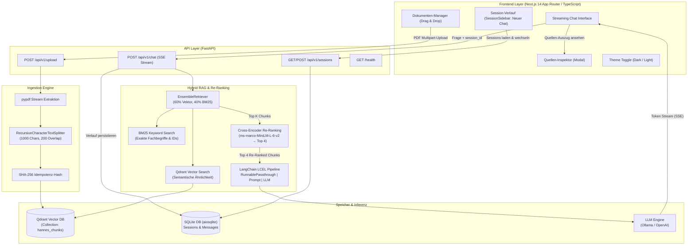

# Hannes AI

[](https://www.python.org/downloads/)
[](https://fastapi.tiangolo.com)
[](https://nextjs.org/)
[](https://www.typescriptlang.org/)
[](https://qdrant.tech/)
[](https://ollama.com/)
[](https://opensource.org/licenses/MIT)

Hannes AI ist eine produktionsreife Enterprise Retrieval-Augmented Generation (RAG) Plattform für präzise Frage-Antwort-Systeme auf Basis von Dokumenten (PDFs). Sie kombiniert dichte Vektorsuche (Cosine) mit lexikalischer Keyword-Suche (BM25), wendet ein lokales Cross-Encoder Re-Ranking (`ms-marco-MiniLM-L-6-v2`) an, streamt Antworten Wort für Wort via Server-Sent Events (SSE) und persistiert Chat-Sitzungen und Quellenangaben in einer lokalen SQLite-Datenbank.

Das System läuft zu 100 % lokal ohne externe Cloud-Abhängigkeiten (Ollama `llama3` + `nomic-embed-text`, lokaler Cross-Encoder, lokales Qdrant). Über Dependency Injection kann bei Bedarf nahtlos auf OpenAI gewechselt werden.

---

## Architektur



---

## Zentrale technische Entscheidungen

### 1. Hybrid Retrieval & Lokales Cross-Encoder Re-Ranking
Reine semantische Vektorsuche scheitert häufig bei exakten Artikelnummern, Paragraphen oder fachspezifischen Begriffen. Hannes AI löst dies zweistufig:
- **Stufe 1 (Hybrid Retrieval):** `EnsembleRetriever` kombiniert dichte Embeddings (`nomic-embed-text`, 768-dim) in Qdrant mit sparse BM25 (`rank_bm25`).
- **Stufe 2 (Cross-Encoder Re-Ranking):** Ein lokales HuggingFace Cross-Encoder Modell (`cross-encoder/ms-marco-MiniLM-L-6-v2` via `sentence-transformers`) bewertet jedes `(Frage, Textauszug)`-Paar gemeinsam und filtert die Top-6 Kandidaten auf die 4 relevantesten Abschnitte herunter.

### 2. Chat-History & Asynchrone Persistenz
- Speicherung aller Sessions und Nachrichten in SQLite über SQLAlchemy 2.0 (`aiosqlite`) mit `selectinload` und strikt typisierten Mappings (`Mapped[...]`, `mapped_column[...]`).
- Historie wird beim Chatten automatisch in den System-Prompt injiziert (letzte Nachrichten), damit mehrstufige Rückfragen beantwortet werden können.
- Automatische Titelgenerierung der Session anhand der ersten Benutzerfrage.
- Saubere Session-Isolation: Neuer Chat wird per Klick auf **"Neuer Chat"** angelegt.

### 3. Server-Sent Events (SSE) Streaming & Source Attribution
- Unidirektionales HTTP-Streaming (`text/event-stream`) anstelle fehleranfälliger WebSockets.
- Typisierte JSON-Frames:
  - `{"type": "token", "content": "..."}`: Inkrementelle Token-Generierung.
  - `{"type": "sources", "sources": [...]}`: Strukturierte Quellenangaben mit Dateiname, Seitenzahl, Relevanzscore und Originaltext.
  - `{"type": "done"}`: Sauberer Abschluss des Streams.

### 4. 100 % Lokal & Vendor-agnostisch
- **Standard:** Vollständig offline lauffähig mit Ollama (`llama3` + `nomic-embed-text`), Qdrant im Docker-Container und lokalem Cross-Encoder.
- **Optional:** Umschaltbar auf OpenAI (`gpt-4o-mini` + `text-embedding-3-small`) durch einfaches Setzen von `LLM_PROVIDER=openai` in `.env`.

### 5. Neutrales Schwarz-Grau UI mit Dark/Light Toggle
- Konsequent gestaltetes Enterprise-Interface mit 3-Spalten-Layout (Chat-Verlauf, Dokumentenverwaltung, Chatbereich).
- Achromatische Farbpalette (`neutral` ohne Blaustich) und Theme-Umschaltung mit Persistenz.

---

## Projektstruktur

```text
hannes-ai/
├── backend/
│   ├── app/
│   │   ├── api/v1/
│   │   │   ├── upload.py           # PDF Upload & Chunking Ingestion Router
│   │   │   ├── chat.py             # SSE Streaming Chat Router
│   │   │   └── sessions.py         # Chat-History & Session REST Router
│   │   ├── core/
│   │   │   ├── config.py           # Pydantic v2 Settings (Typ-sicher)
│   │   │   ├── dependencies.py     # FastAPI Dependency Injection
│   │   │   └── logging.py          # Strukturiertes structlog JSON-Logging
│   │   ├── db/
│   │   │   ├── models.py           # SQLAlchemy 2.0 ORM (ChatSession, ChatMessage)
│   │   │   ├── database.py         # Async SQLite Engine (aiosqlite)
│   │   │   └── repository.py       # Session & Message Data-Access Layer
│   │   ├── schemas/
│   │   │   ├── upload.py           # Ingestion Request/Response Schemas
│   │   │   ├── chat.py             # Chat Query & SSE Event Schemas
│   │   │   └── session.py          # Session & History Schemas
│   │   ├── services/
│   │   │   ├── ingestion.py        # PDF Parsing (pypdf), Splitter & Qdrant Upsert
│   │   │   ├── reranker.py         # Cross-Encoder Re-Ranking (HuggingFace)
│   │   │   └── rag.py              # Hybrid Retrieval, Re-Ranking & LCEL Execution
│   │   └── main.py                 # FastAPI Application Factory & Lifespan
│   ├── tests/
│   │   ├── conftest.py             # Pytest Fixtures & Mocks
│   │   ├── test_upload.py          # Upload-Validierungstests
│   │   ├── test_rag.py             # Retrieval-, Deduplizierungs- & Streamingtests
│   │   ├── test_chat.py            # Chat-Vertragstests (SSE)
│   │   └── test_sessions.py        # Session- und Persistenztests
│   ├── Dockerfile                  # Multi-Stage Build (python:3.11-slim)
│   └── requirements.txt            # Fixierte Abhängigkeiten
├── frontend/
│   ├── src/
│   │   ├── app/
│   │   │   ├── layout.tsx          # Root Layout mit Metadaten & Theme Support
│   │   │   ├── globals.css         # Achromatische Scrollbars & Focus-Styles
│   │   │   └── page.tsx            # 3-Spalten-Layout (Verlauf | Dokumente | Chat)
│   │   ├── components/
│   │   │   ├── SessionSidebar.tsx  # Chat-Verlauf mit Session-Switching & "Neuer Chat"
│   │   │   ├── DocumentManager.tsx # Drag & Drop PDF-Upload & Statusliste
│   │   │   ├── ChatInterface.tsx   # SSE Stream Reader & Prompt Input
│   │   │   ├── MessageBubble.tsx   # Markdown Renderer & Quellen-Badges
│   │   │   ├── SourceModal.tsx     # Quelltext-Ausschnitt Inspector
│   │   │   ├── ThemeToggle.tsx     # Dark- / Light-Mode Switcher
│   │   │   └── ui/                 # Wiederverwendbare UI-Komponenten (Button, Badge)
│   │   ├── lib/
│   │   │   ├── api.ts              # Typisierter API Client (Fetch)
│   │   │   ├── sse.ts              # SSE ReadableStream Event Parser
│   │   │   └── utils.ts            # Formatting Utilities
│   │   └── types/                  # TypeScript Interfaces
│   ├── Dockerfile                  # Next.js Standalone Build
│   └── package.json
├── docker-compose.yml              # Multi-Container Setup (Qdrant, Backend, Frontend)
├── .env.example                    # Konfigurationsvorlage
└── README.md
```

---

## Schnellstart

### Voraussetzungen
- Docker Desktop / Docker Engine & Docker Compose
- [Ollama](https://ollama.com/) installiert und gestartet mit den Modellen:
  ```bash
  ollama pull llama3
  ollama pull nomic-embed-text
  ```

### 1. Konfiguration
```bash
git clone https://github.com/your-username/hannes-ai.git
cd hannes-ai

cp .env.example .env
```

### 2. Container starten
```bash
docker compose up --build -d
```

### 3. Zugriff
- **Web-Interface:** [http://localhost:3000](http://localhost:3000)
- **FastAPI Swagger Docs:** [http://localhost:8000/docs](http://localhost:8000/docs)
- **Qdrant Dashboard:** [http://localhost:6333/dashboard](http://localhost:6333/dashboard)
- **Health Check:** [http://localhost:8000/health](http://localhost:8000/health)

---

## Tests & Code-Qualität

```bash
# Backend Tests mit Pytest
cd backend
pytest tests/ -v

# TypeScript Type-Check
cd frontend
npm run type-check
```

---

## Lizenz
MIT License.
